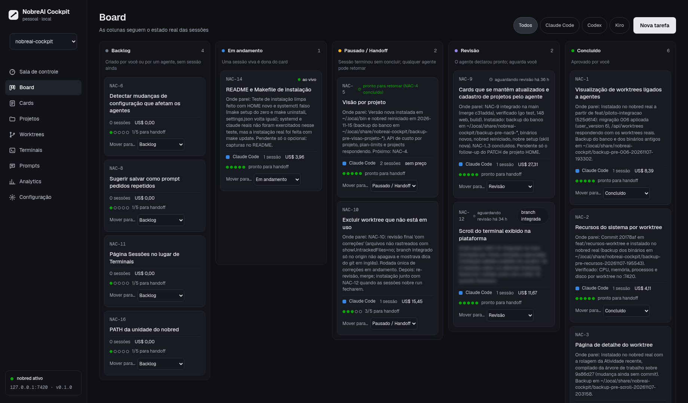
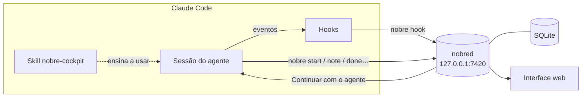
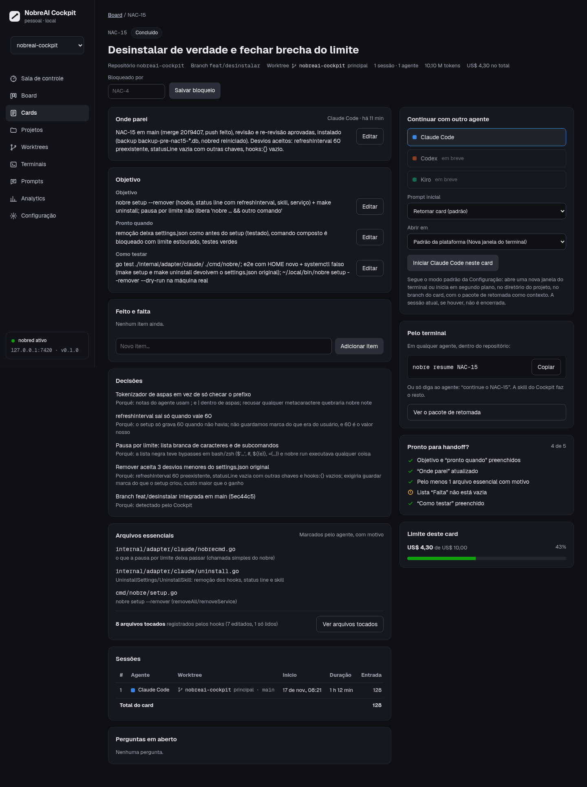
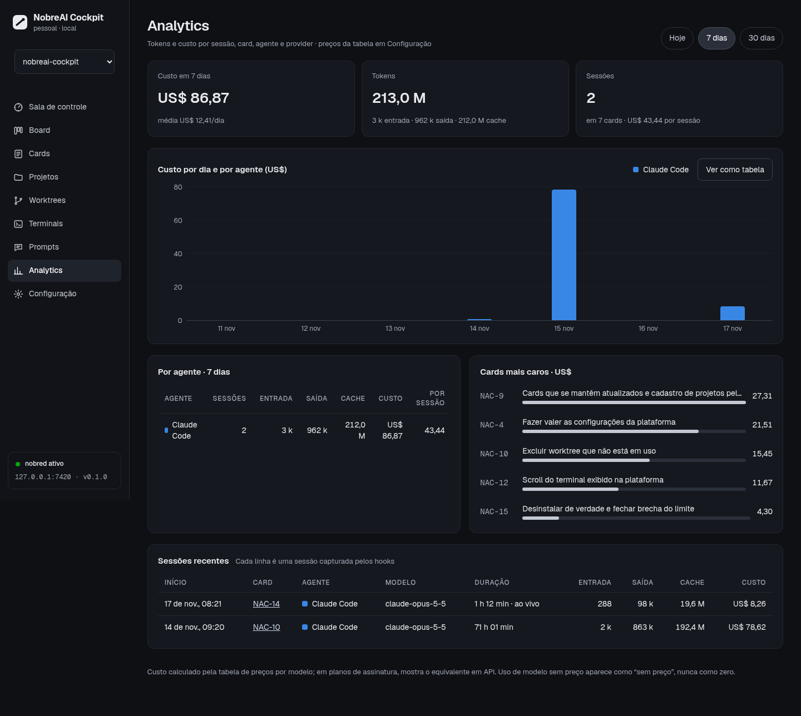
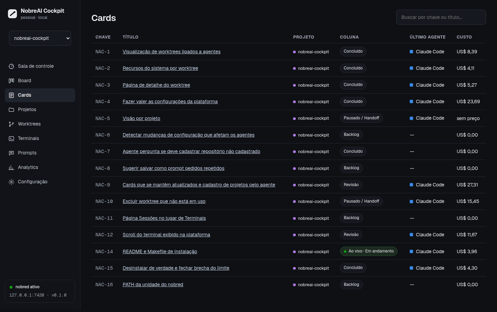

# NobreAI Cockpit

**Troque de sessão ou de agente sem perder o contexto.** Hooks do Claude Code
registram decisões, arquivos, pendências e custo em cards que qualquer agente
retoma com `nobre resume`. Local-first, Go + SQLite.

```text
sessão 1   nobre start "Login com OAuth" --goal "entrar com Google"
           nobre decide "PKCE em vez de segredo no cliente" --why "o app é público"
           nobre note "callback pronto; falta validar o state"
           ... a sessão acaba, o card vai para Pausado ...
sessão 2   nobre resume NAC-7   # objetivo, decisões, arquivos, onde parou e o que falta
```

Na prática, você nem digita esses comandos: a skill instalada ensina o agente
a manter o card, e os hooks registram o esqueleto (prompts, arquivos editados,
comandos e tokens) mesmo quando ele esquece. A sessão nova começa a trabalhar
sem perguntar o que estava sendo feito.

Além disso, o Cockpit mostra quais agentes estão rodando agora, quantos tokens
cada sessão, card e projeto gastou e quanto isso custou, e pode pausar um
agente que estoure o limite de custo. Tudo roda na sua máquina: um daemon que
escuta só em `127.0.0.1`, um banco SQLite e uma interface web embutida no
binário.



<sub>O board com os cards do próprio desenvolvimento do Cockpit, que é gerenciado
por ele mesmo.</sub>

> Estado atual: piloto funcional com o **Claude Code**, em **Linux com
> systemd** e **macOS**. Os adaptadores para Codex e Kiro, o modo tmux, os limites mensais
> e o servidor MCP ainda não existem.

## Sumário

- [Como funciona](#como-funciona) (inclui o [design](#design))
- [Requisitos](#requisitos)
- [Instalação](#instalação)
- [Primeiros passos](#primeiros-passos)
- [Usando no dia a dia](#usando-no-dia-a-dia)
- [Monorepo e sub-projetos](#monorepo-e-sub-projetos)
- [Referência do comando `nobre`](#referência-do-comando-nobre)
- [Atualizar](#atualizar)
- [Onde ficam os arquivos](#onde-ficam-os-arquivos)
- [Desinstalar](#desinstalar)
- [Desenvolvimento](#desenvolvimento)
- [Problemas comuns](#problemas-comuns)
- [Licença](#licença)

## Como funciona



São dois binários:

| Peça | O que faz |
|---|---|
| `nobred` | Daemon local. Guarda tudo num banco SQLite, serve a API HTTP, o stream de eventos e a interface web (embutida no binário). Escuta só em loopback (`127.0.0.1:7420`) e recusa qualquer outro endereço. Roda como serviço de usuário do systemd. |
| `nobre` | CLI. O agente usa para criar e atualizar o card; você usa para administrar (projetos, prompts, setup). Os hooks do Claude Code também chamam o `nobre`. |

O registro acontece por dois caminhos, e um cobre o outro:

1. **Hooks (automático).** O `nobre setup` instala hooks no Claude Code
   (`SessionStart`, `UserPromptSubmit`, `PreToolUse`, `PostToolUse`, `Stop` e
   `SessionEnd`). Eles registram a sessão, os prompts, os arquivos editados, os
   comandos e os tokens gastos, mesmo que o agente esqueça de anotar. No início
   de cada sessão o hook injeta no contexto do agente as regras do Cockpit e os
   cards pausados daquele repositório e branch. Os hooks nunca quebram o
   agente: se o daemon estiver fora do ar, eles simplesmente não registram.
2. **Skill (o agente escreve).** A skill `nobre-cockpit` ensina o agente a
   criar o card (`nobre start`) quando começa uma tarefa de várias etapas, a
   atualizar "Onde parei" a cada passo, a registrar decisões, arquivos e
   pendências, e a marcar o card como pronto (`nobre done`) no final.

### O board

As colunas são **Backlog → Em andamento → Pausado → Revisão → Concluído**, e o
card se move sozinho conforme o que acontece de fato:

- uma sessão liga o card a ela → **Em andamento**;
- a sessão termina sem concluir → **Pausado** (pronto para handoff);
- o agente roda `nobre done` → **Revisão**;
- você aprova na interface → **Concluído**.

Um card só fica "Em andamento" enquanto existe uma sessão viva ligada a ele. Um
reconciliador encerra as sessões cujo processo sumiu.

### Handoff

Há duas formas de continuar um card:

- **Pela interface:** no card, clique em **Continuar**. O daemon abre o Claude
  Code num terminal novo (ou em segundo plano, com a saída na própria
  interface), no worktree do branch do card quando ele existe, com o pacote de
  retomada já no contexto.
- **Pelo terminal:** peça ao agente para retomar `NAC-12`, ou rode
  `nobre resume NAC-12` dentro da sessão. O comando imprime o pacote de
  retomada e liga a sessão ao card.

### Interface web

Abra com `nobre ui` (ou em `http://127.0.0.1:7420`):

| Página | Para quê |
|---|---|
| Sala de controle | Agentes rodando agora, alertas, custo do dia, limites do plano |
| Board | O kanban, com sinais como "bloqueado por NAC-x", "parado" e "aguardando você" |
| Cards | Lista pesquisável; cada card abre como um documento de handoff |
| Projetos | Repositórios cadastrados, com custo e cards por projeto |
| Worktrees | Worktrees ligados a agentes e o consumo de recursos de cada um |
| Terminais | Agentes rodando dentro da plataforma (`nobre run` ou "Continuar" em segundo plano) |
| Prompts | Prompts salvos com variáveis |
| Analytics | Tokens e custo por sessão, card, agente e dia |
| Configuração | Agentes detectados, projetos, preços, moeda, limites e regras de handoff |

<table>
  <tr>
    <td width="50%"><br><sub><b>Card como documento de handoff:</b> onde parou, decisões com o porquê, arquivos essenciais, sessões e custo.</sub></td>
    <td width="50%"><br><sub><b>Analytics:</b> tokens e custo por dia, agente, card e sessão.</sub><br><br><br><sub><b>Cards:</b> todos os cards com coluna, último agente e custo.</sub></td>
  </tr>
</table>

### Design

As telas foram desenhadas no Claude Design, no canvas
[NobreAI Cockpit](https://claude.ai/artifact/VZs84mPU4RS1rWCPQg2K8L) (acesso
restrito). Ele tem três páginas:

- **Beta 1 · PT:** Sala de controle, Board, Card (handoff), Analytics,
  Configuração e Prompts. É a base da interface atual.
- **Beta 2 · EN:** o roadmap, com privacidade, setup guiado, inbox de
  aprovações, sessão ao vivo, projetos, times, cobrança, login e celular. A
  maior parte ainda não está implementada.
- **Brand & site:** propostas de ícone e quatro direções de site.

## Requisitos

- **Linux com systemd** ou **macOS** (o daemon roda como serviço de usuário:
  unidade do systemd no Linux, LaunchAgent do launchd no macOS).
- **Go** na versão do `go.mod` (hoje 1.26.5) ou mais nova.
- **Node.js** e **pnpm**, para compilar a interface (testado com Node 24 e
  pnpm 11).
- **git** e **curl**.
- **Claude Code** instalado e autenticado.
- Um terminal gráfico (gnome-terminal, konsole, xfce4-terminal, terminator,
  xterm, alacritty, kitty…) para o botão "Continuar" abrir janelas. No macOS
  ele usa o Terminal.app.

## Instalação

```bash
git clone https://github.com/jacubovskib/nobreai-cockpit.git
cd nobreai-cockpit
make check     # confere as dependências
make setup     # compila, instala em ~/.local/bin e configura tudo
```

O daemon não guarda o `PATH` do terminal onde você rodou o setup. Toda vez que
abre um agente ("Continuar" ou `nobre run`) ou procura o `claude`, ele pergunta
o `PATH` ao seu shell de login (bash ou zsh). Assim, trocar a versão do Node,
de um venv ou do mise não quebra nada, e não é preciso reinstalar. A unidade do
systemd (ou o LaunchAgent, no macOS) guarda o `PATH` do terminal do setup só
como reserva, para quando o shell não puder ser consultado (fish, por exemplo).

O `make setup` faz, em ordem:

1. `make build`: compila a interface web (`pnpm`) e os binários `nobre` e
   `nobred`, com a interface embutida.
2. `make install`: copia os binários para `~/.local/bin`.
3. Roda `~/.local/bin/nobre setup`, que:
   - instala os hooks e a status line no `~/.claude/settings.json`, depois de
     gravar um backup `settings.json.bak-<data>` ao lado. O arquivo é regravado
     com as chaves em ordem alfabética, mas o seu conteúdo é preservado;
   - instala a skill em `~/.claude/skills/nobre-cockpit/SKILL.md`;
   - grava `~/.config/systemd/user/nobred.service` e roda
     `systemctl --user enable --now nobred` (no macOS, grava
     `~/Library/LaunchAgents/io.nobretech.nobred.plist` e o carrega com
     `launchctl bootstrap`);
   - pergunta se o repositório atual deve ser cadastrado como projeto.

O setup roda sempre a partir do binário instalado, nunca do clone: os hooks e
o serviço gravam o caminho absoluto de quem rodou o setup.

Para ver o que mudaria antes de gravar qualquer coisa:

```bash
make setup-dry-run
```

Opções:

```bash
make setup PREFIX=/opt/nobre               # instala em /opt/nobre/bin
make setup SETUP_ARGS=--sem-statusline     # não mexe na status line do Claude Code
```

Para conferir:

```bash
make status    # serviço ativo e API respondendo
nobre ui       # abre a interface
```

Na interface, em **Configuração → Agentes detectados**, o Claude Code deve
aparecer como detectado e com os hooks instalados. Se faltar algo, use
**Instalar o que falta**.

## Primeiros passos

1. **Cadastre os preços dos modelos.** Em **Configuração → Preços e moeda**,
   adicione o modelo que você usa e preencha entrada, saída e cache (US$ por
   milhão de tokens). Sem preço, o custo aparece como "sem preço", nunca como
   zero.
2. **Cadastre seus repositórios.** Dentro de cada repositório:

   ```bash
   nobre project add
   nobre project list
   ```

   Também dá para cadastrar em **Configuração → Projetos**. Se o agente abrir
   uma sessão num repositório ainda não cadastrado, a skill o cadastra sozinha
   e sugere cards a partir dos branches e planos em andamento.
3. **Trabalhe normalmente.** Abra o `claude` no repositório e peça uma tarefa
   de várias etapas. O agente cria o card, e você acompanha no **Board** sem
   recarregar a página.

Para conhecer a interface sem dados reais:

```bash
make demo      # sobe um nobred de demonstração em http://127.0.0.1:7421
```

A demonstração usa um banco separado (`cockpit-demo.db`) e nunca toca no banco
real.

## Usando no dia a dia

Você quase não digita comandos `nobre`: o agente cuida disso. Um ciclo típico:

```text
você:    "Adicione login com Google, com testes"
agente:  nobre start "Login com OAuth" --goal "entrar com Google" --done-when "testes passam"
agente:  nobre branch feat/oauth
agente:  nobre decide "PKCE em vez de segredo no cliente" --why "o app é público"
agente:  nobre file auth/oauth.go --why "fluxo do callback"
agente:  nobre note "callback pronto; falta validar o state"
         ... a sessão acaba: o card vai para Pausado ...
você:    (outra sessão) "retome NAC-7"
agente:  nobre resume NAC-7     → recebe o pacote e continua
agente:  nobre test "go test ./auth/..."
agente:  nobre done             → card vai para Revisão
você:    aprova na interface    → Concluído
```

O `nobre done` é recusado se "Como testar" estiver vazio ou mais antigo que a
última edição de arquivo, ou se houver pergunta sem resposta.

### Ver o agente na plataforma

```bash
nobre run claude
```

Roda o Claude Code no seu terminal e, ao mesmo tempo, na página **Terminais**.
`Ctrl+]` solta o terminal local sem encerrar o agente. Na interface, o terminal
abre em "Somente assistir" até você clicar em **Interagir**.

### Limites de custo

Em **Configuração → Limites de custo**, defina para cada agente um limite diário e um
limite por card, em US$. O aviso aparece no percentual configurado (padrão
80%). Em 100%, com a ação "bloquear", o hook nega as
ferramentas do agente (só os comandos de handoff do `nobre`, como `note`, `status` e `done`, sem nada encadeado, continuam liberados, para ele registrar
o handoff) e move o card para Pausado com o motivo "limite de custo".

## Monorepo e sub-projetos

Um monorepo pode ter um sub-projeto por app. Cadastre a raiz e ligue cada app a ela:

```sh
nobre project add ~/workspace/loja
nobre project add ~/workspace/loja/apps/web --pai ~/workspace/loja   # ou --pai <id>
nobre project pai <projeto> <pai>                        # liga um projeto que já existe (id, pasta, ou nome de grupo)
nobre project pai <projeto> --nenhum                     # desliga
nobre project grupo "Clientes"                           # grupo de repositórios, sem pasta
nobre project scan                                       # sugere os apps
nobre project scan --nao-sugerir apps/old,packages/x      # recusa pastas relativas, separadas por vírgula
```

- A sessão cai no app cuja pasta contém o `cwd`; na raiz, cai no projeto principal.
- O agente põe o card no app certo com `nobre app <nome>` (`nobre app --geral` devolve ao principal). Na página do card, o campo Projeto também troca o app.
- A captura é do projeto principal e vale para os apps. Os filtros e as somas de um monorepo ou grupo juntam os filhos.
- Na Configuração, Projetos: "Novo grupo", "Mover para…", "Desligar do projeto principal" e as sugestões ("Adicionar selecionados", "Não sugerir estes").

Grupo com pasta: uma pasta que não é repositório git (por exemplo `~/workspace/clientes`, com vários repositórios dentro) também pode virar um grupo.

```sh
nobre project add ~/workspace/clientes                   # pasta sem git: cadastra um grupo com pasta, se achar repositórios dentro dela
```

- O grupo com pasta não usa git: não tem branch, worktree nem base. Ele aceita cards (o grupo sem pasta continua recusando) e aparece em Worktrees só como cabeçalho, com os repositórios dos filhos abaixo.
- Na Configuração, "Adicionar projeto" abre o seletor de pasta. Escolha a pasta e o Cockpit varre os sub-projetos (repositório, monorepo ou grupo) e cadastra tudo de uma vez, com os sub-projetos que você marcar. "Varrer de novo" repete a varredura numa pasta já cadastrada.
- Na página do projeto principal, a linha "geral" da tabela "Por app" mostra `(raiz)`: é o que caiu no principal e não em um app.

## Referência do comando `nobre`

Comandos para o agente (dentro de uma sessão):

| Comando | O que faz |
|---|---|
| `nobre start "<título>" [--goal …] [--done-when …]` | Cria um card e liga esta sessão a ele |
| `nobre resume <KEY> [--force]` | Liga a sessão ao card e imprime o pacote de retomada |
| `nobre card add "<título>" [--goal …] [--done-when …] [--branch …] [--where …] [--column backlog\|pausado]` | Cria um card sem ligar a sessão |
| `nobre note "<onde parei>"` | Atualiza "Onde parei" |
| `nobre decide "<decisão>" --why "<porquê>"` | Registra uma decisão |
| `nobre file <caminho> --why "<motivo>" [--lines L12-96]` | Marca um arquivo essencial |
| `nobre todo add "<texto>"` / `nobre todo done <id>` | Adiciona ou conclui uma pendência |
| `nobre plan <arquivo> --task "<tarefa>" …` / `nobre task <n> <estado>` | Registra as tarefas do plano e muda o estado de cada uma |
| `nobre ask "<pergunta>"` / `nobre answer <id> "<resposta>"` | Abre ou responde uma pergunta para você |
| `nobre block <KEY> [--why …]` / `nobre block --clear` | Marca que o card depende de outro |
| `nobre branch <nome>` | Informa o branch de trabalho do card |
| `nobre test "<como testar>"` | Registra como testar |
| `nobre done [--force]` | Marca o card como pronto para revisão |
| `nobre status` | Mostra o card e o que falta para o handoff |

Comandos de administração:

| Comando | O que faz |
|---|---|
| `nobre project add [caminho] [--name <nome>] [--pai <id\|pasta>]` | Cadastra um repositório (ou um app de monorepo, com `--pai`). Numa pasta que não é git e tem repositórios dentro, cadastra um grupo com pasta (não aceita `--pai`) |
| `nobre project pai <projeto> <pai\|--nenhum>` | Liga ou desliga um projeto de um pai |
| `nobre project grupo "<nome>"` | Cria um grupo de repositórios |
| `nobre app <nome>` / `nobre app --geral` | Põe o card no app do monorepo, ou no principal |
| `nobre project scan [caminho]` | Levanta branches, planos, sessões e cards (só leitura) |
| `nobre project base <branch> [caminho]` | Define o branch base do projeto |
| `nobre project list` | Lista os projetos |
| `nobre prompt list` / `use <slug> [--card KEY]` / `save --name <n> --tag <t>` | Prompts salvos |
| `nobre run <agente> [args…]` | Roda o agente com o terminal visível na plataforma |
| `nobre ui` | Abre a interface no navegador |
| `nobre setup [--dry-run] [--sem-statusline]` | Instala hooks, skill e status line e ativa o daemon |
| `nobre setup --remover-statusline` | Desfaz só a integração da status line |
| `nobre setup --remover [--dry-run]` | Desfaz o setup: hooks, status line, skill e serviço (binários e banco ficam) |

`nobre help` e `nobre <comando> --help` mostram a ajuda completa. O daemon é
procurado em `NOBRE_ADDR` (padrão `127.0.0.1:7420`).

### Alvos do `make`

| Alvo | O que faz |
|---|---|
| `make` / `make help` | Lista os alvos |
| `make check` | Confere go, node, pnpm, git, curl, systemd (ou launchd), claude e o `PATH` |
| `make setup` | Compila, instala e configura (primeira instalação) |
| `make setup-dry-run` | Mostra o que o setup mudaria, sem gravar nada |
| `make build` | Compila `./nobre` e `./nobred` com a interface embutida |
| `make install` | Copia os binários para `$(BINDIR)` (padrão `~/.local/bin`) sem reiniciar o daemon |
| `make update` | Reinstala e reinicia o daemon |
| `make restart` | Reinicia o daemon |
| `make status` | Mostra o serviço e se a API responde |
| `make logs` | Acompanha o log do daemon (`journalctl`; no macOS, `~/Library/Logs/nobred.log`) |
| `make demo` | Sobe um daemon de demonstração em `127.0.0.1:7421` |
| `make uninstall` | Desfaz o setup e apaga os binários (o banco fica) |
| `make uninstall-dry-run` | Mostra o que o `make uninstall` removeria |
| `make test` | `go vet`, testes Go e testes da interface |
| `make clean` | Apaga os binários e o build da interface |

### No macOS

Os mesmos comandos valem no macOS (testado no CI em `macos-latest`). O que
muda:

- O `nobred` roda como LaunchAgent (`io.nobretech.nobred`): o `make restart`
  usa `launchctl kickstart -k`, o `make status` mostra o `launchctl print` e o
  log fica em `~/Library/Logs/nobred.log`.
- O "Continuar" abre o agente numa janela do Terminal.app (via `osascript`).
  Na primeira vez o macOS pede permissão para o `nobred` controlar o Terminal
  (Ajustes do Sistema → Privacidade e Segurança → Automação). Para outro
  terminal (kitty, alacritty), troque o comando em **Configuração**. O modo
  "em segundo plano" (terminal dentro da plataforma) funciona igual.
- O monitor de CPU e memória por worktree ainda depende do `/proc` e fica
  vazio no macOS. O resto (sessões, cards, custo, hooks) funciona igual.

Para migrar de um daemon rodado na mão: pare-o, rode `make setup` e confira
com `make status`.

## Atualizar

```bash
git pull
make update
```

O `make update` recompila, reinstala os binários e reinicia o `nobred`.
**Reiniciar encerra os terminais que estão rodando dentro da plataforma**
(`nobre run` e "Continuar" em segundo plano). As sessões abertas em janelas de
terminal normais continuam. Se houver agentes rodando na plataforma, use
`make install` agora e `make restart` depois.

Só é preciso rodar `make setup` de novo se a skill ou os hooks mudarem (o
`PATH` o daemon pega do seu shell na hora). O setup é idempotente: o que já está certo fica como está.

## Onde ficam os arquivos

| Caminho | Conteúdo |
|---|---|
| `~/.local/bin/nobre`, `~/.local/bin/nobred` | Binários |
| `~/.local/share/nobreai-cockpit/cockpit.db` | Banco (respeita `XDG_DATA_HOME`) |
| `~/.local/share/nobreai-cockpit/cockpit-demo.db` | Banco da demonstração |
| `~/.config/systemd/user/nobred.service` | Serviço do daemon |
| `~/.claude/settings.json` | Hooks e status line (backup em `settings.json.bak-<data>`) |
| `~/.claude/skills/nobre-cockpit/SKILL.md` | Skill do agente |

Para fazer backup dos seus dados, copie o `cockpit.db` com o daemon parado.

## Desinstalar

```bash
make uninstall-dry-run   # mostra o que seria removido
make uninstall
```

O `make uninstall` roda `nobre setup --remover` e depois apaga os binários de
`~/.local/bin`. O `--remover` desfaz o setup na ordem certa:

1. tira os hooks do Cockpit do `~/.claude/settings.json` e devolve a status
   line original, mantendo os hooks e as configurações de outras ferramentas
   (com backup `settings.json.bak-<data>` antes de gravar);
2. apaga a skill `~/.claude/skills/nobre-cockpit`;
3. para o `nobred` e apaga a unidade do systemd.

O banco em `~/.local/share/nobreai-cockpit/` fica, caso você queira guardá-lo.
Depois, reinicie as sessões do Claude Code que estiverem abertas: cada sessão
guarda os hooks de quando começou e continuaria chamando o `nobre` apagado.

## Desenvolvimento

```bash
go run ./cmd/nobred          # daemon em :7420 (use NOBRE_ADDR para outra porta)
pnpm -C web dev              # Vite em :5173, com proxy de /api para o daemon
make test                    # go vet, go test e vitest
```

Estrutura:

| Pasta | Conteúdo |
|---|---|
| `cmd/nobre` | CLI, hooks, setup, `nobre run` e status line |
| `cmd/nobred` | Daemon |
| `internal/adapter/claude` | Adaptador do Claude Code: hooks, skill, ingestão dos transcripts |
| `internal/api` | API HTTP, stream SSE e WebSocket dos terminais |
| `internal/board` | Regras do kanban e reconciliação |
| `internal/store` | Banco SQLite e migrações |
| `internal/pty`, `internal/launch` | Terminais da plataforma e abertura do "Continuar" |
| `internal/e2e` | Teste de ponta a ponta do handoff |
| `web` | Interface (React + Vite), embutida no `nobred` |
| `docs` | Spec, planos e status do piloto |

Um binário compilado sem `make web` funciona, mas a interface mostra só uma
página pedindo para rodar `make web` e `make build`.

O design está em [`docs/spec.md`](docs/spec.md), o estado atual em
[`docs/status-piloto.md`](docs/status-piloto.md) e o roteiro de teste manual em
[`docs/piloto-checklist.md`](docs/piloto-checklist.md).

## Problemas comuns

**`make check` diz que `~/.local/bin` não está no PATH.** Acrescente ao
`~/.zshrc` ou `~/.bashrc`: `export PATH="$HOME/.local/bin:$PATH"`.

**O "Continuar" não acha o `claude`.** O daemon procura o `claude` no `PATH`
do seu shell de login. Confira em **Configuração → Agentes detectados** se o
item "CLI encontrado" está ok. Se não estiver, coloque o diretório do `claude`
no `PATH` do seu `~/.zshrc` ou `~/.bashrc` (não precisa reiniciar o daemon). Com
um shell que não seja bash nem zsh, o daemon usa o `PATH` de reserva da
unidade: rode `make setup` num terminal onde o `claude` funciona. Se a consulta
ao shell falhar, o motivo aparece em `make logs`.

**A Sala de controle mostra um alerta de integração.** O Cockpit confere
os hooks, a skill e a status line do Claude Code e avisa quando algo que já
funcionou parou (por exemplo, hooks removidos do `~/.claude/settings.json`).
O botão **Reinstalar** mostra antes o que vai mudar e só altera o arquivo
depois de **Confirmar**. **Ignorar** silencia o alerta enquanto aquele item
continuar como estava: ele só volta se o próprio item mudar de novo (outro
comando na status line, a skill reescrita, outros hooks faltando). Mexer em
outras partes do `~/.claude/settings.json` não traz o alerta de volta. O
histórico fica em **Configuração → Histórico de mudanças**.

**O "Continuar" não abre o terminal.** Confira em **Configuração** o comando do
terminal. O daemon o procura no `PATH` do seu shell de login.

**A interface diz que o binário foi gerado sem a interface.** Rode
`make build` (ele compila a interface antes) e `make update`.

**O custo aparece como "sem preço".** Falta o preço do modelo em
**Configuração → Preços e moeda**.

**Os cards não aparecem.** Confira `make status`; veja `make logs`; confirme
que o repositório está em `nobre project list` e que o Claude Code mostra os
hooks em **Configuração → Agentes detectados**.

## Licença

MIT. Veja [LICENSE](LICENSE).
